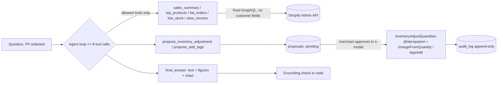

# Store Ops Assistant (Shopify app)

Merchants ask about sales, orders and inventory inside the Shopify admin. The agent reads data **only through fixed, pre-validated GraphQL tools**, shows every step it took, and can only **propose** changes — the merchant approves each one in a modal, and every decision is logged.

> Status: **v0 — first working build.** Builds, type-checks, unit tests pass. Not yet run against a development store; the 30-question accuracy set has not been built. Designed against BFS criteria — not BFS certified.

## Screens

| Screen | What the merchant does |
|---|---|
| **Home** | Last-7-days sales, orders, average order (computed by code, no AI), sales chart, "needs your attention" list |
| **Ask** | Types a question or picks an example; sees the answer, a figure table with period + source step, a chart, and the steps the agent took |
| **Suggested actions** | Opens each proposal in an `s-modal` showing *now → after approval*; approves or dismisses |
| **Activity log** | Who approved what and when (append-only) |
| **Thresholds** | Low-stock threshold, slow-mover window (Contextual Save Bar) |

## How the agent is constrained



| Requirement | How |
|---|---|
| 4.1/4.2 predefined tools only | `app/lib/tools.server.ts` — model picks a tool + typed args (`strict: true`); unknown tool names are rejected |
| 4.3 ≤ 8 steps, steps visible | `MAX_STEPS` in `agent.server.ts`; steps stored per run and shown under the answer |
| 4.4 numbers from tools, with period | `final_answer` requires figures with `period` and `sourceStep`; `checkGrounding` flags any number not found in tool data → answer marked "could not be checked" |
| 4.7 approval in `s-modal` | Proposals hold the exact mutation input + a before/after preview |
| 4.8 audit log | `audit_log` table + DB trigger that rejects updates |
| 4.10 no customer PII to the model | Queries request no customer fields; order notes and the question are redacted; notes are labelled `_untrusted` |
| Prompt injection in order notes | Notes are data; write tools only accept IDs returned by read tools in the same run, and nothing executes without a click |
| Safe writes | `@idempotent(key: proposalId)` + `changeFromQuantity` (compare-and-swap) on inventory; proposals are claimed atomically |

GraphQL operations were validated against Admin API **2026-10** with the Shopify AI Toolkit.

## Run it

```bash
nvm use 22
npm install
docker compose up -d
cp .env.example .env
npx prisma migrate deploy
shopify app dev
npm test
```

Without `ANTHROPIC_API_KEY` the app runs in demo mode: a keyword router calls the same tools and fills a template answer.

## Acceptance criteria — status

| Criterion | Status |
|---|---|
| 30 questions with precomputed answers, ≥85% numbers correct | Not built yet |
| 100% of writes have a merchant approval record | Enforced in `executeProposal`; needs e2e test |
| Shop A session cannot read shop B | Admin client comes from the session; DB queries filter by `shopId`; needs e2e test |
| Dangerous instructions in order notes do not cause proposals | Mitigations in place; needs adversarial test set |
| Logs/prompts contain no email/phone/address | Redaction unit-tested; needs log scan test |
| Passes Agent Review (project 1) | Not run yet |

If listed under the **Analytics** category, BFS 5.3.1 requires Web Pixel — this rule is in the project 1 rule set from the start.

## Known gaps (v0)

- 4.11 weekly summary (nice-to-have) not started.
- Orders older than 60 days need `read_all_orders`.
- Order scans cap at 1,000 orders per question; larger shops need ShopifyQL or bulk operations.
